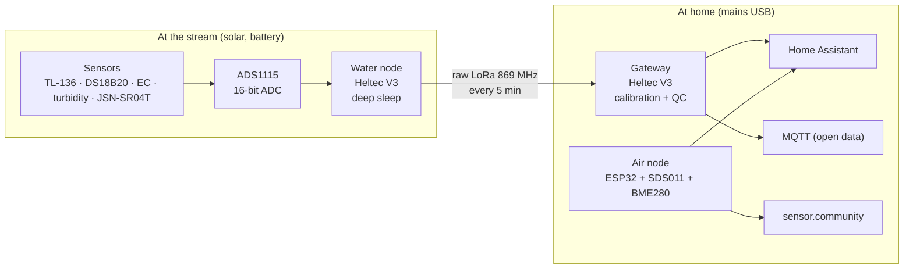

# De Meetbeek: citizen-science brook monitoring


moved to: https://github.com/geert2/water-management-brook-groundwater

A low-cost, open-source monitoring station for **De Grote Beek** (Hansbeke, Flanders). It
measures water level, temperature, conductivity and turbidity, plus air quality nearby, and
shares the data openly. It is designed so that people with limited electronics skills can
build it.

> **Status:** design and parts-buying phase. The ESPHome files pass ESPHome's configuration
> check but have not yet run on hardware. Work through [docs/bench-test.md](docs/bench-test.md)
> and report what you find.

## What you can (and cannot) conclude from the data

The sensors are inexpensive. Expect **trustworthy trends and events** (a storm raising
turbidity and level, conductivity dropping after rain, a warm spell), not laboratory accuracy.

| Measurement | Realistic use |
|-------------|---------------|
| Water level (TL-136 + ultrasonic cross-check) | good, if checked against a staff gauge |
| Water temperature (DS18B20) | good |
| Conductivity (EC, temperature compensated) | good after calibration in a 1413 µS/cm standard (sensor spec ±10 % of full scale), re-check every ~3 months |
| Turbidity | **relative index** and storm detector; coarse below ~50 NTU; needs weekly cleaning |
| PM2.5 / PM10 (SDS011) | indicative; reads high when humidity is above ~70 % |

Every value comes with **quality flags** and the **raw voltages** so data can be re-calibrated later.

## How it works



**Design choices**

* **Raw LoRa** between two Heltec V3 boards using ESPHome's `sx126x` component. It is
  simple and needs no network server. LoRaWAN stays possible later because the radio is the
  same chip.
* **Raw values travel, calibration happens in the gateway.** Re-calibrating means editing one
  block of constants at home, not climbing to the stream.
* The node sends every reading twice and the gateway counts lost readings and node resets.
* The node sleeps almost all of the time (about 15 s awake per 5 minutes).

## Hardware

| Part | Used for |
|------|----------|
| 2 × Heltec WiFi LoRa 32 **V3** (with 868 MHz antennas) | water node and gateway |
| TL-136 submersible level sensor (4–20 mA) | water level |
| DS18B20 waterproof probe | water temperature |
| DFRobot **SEN0244** Gravity analog TDS sensor | conductivity (EC), 0–2000 µS/cm |
| DFRobot **SEN0189** Gravity analog turbidity sensor | turbidity index |
| JSN-SR04T waterproof ultrasonic sensor | level cross-check |
| **ADS1115** breakout | accurate analog readings |
| 12 V solar panel (about 10 W) + **CN3791** MPPT charger | solar charging |
| 2 × 18650 cells in **parallel**, protected, plus 2 A fuse | battery |
| 2 × **MT3608** boost module (one set to 5 V, one to about 15 V) | sensor supplies, powered through the Heltec Vext switch so they are off during sleep (XL6009 cannot be used: its minimum input is 5 V) |
| *(only if needed, see wiring.md options B/C)* AO3401 P-MOSFET + 2N7002 or BC327 + BC337; resistors (160 Ω shunt, 100 Ω, 1 kΩ, 2 kΩ, 4.7 kΩ, 2 × 10 kΩ, 2 × 100 kΩ), 100 µF capacitors | power switch, shunt, dividers |
| ESP32 DevKit, SDS011, BME280 | air quality node (5 V USB supply) |
| IP66 enclosures, cable glands, desiccant | housing |

Wiring and pins, with seven wiring diagrams: [docs/wiring.md](docs/wiring.md).

## Repository layout

```
esphome/
  brook_sensor_node.yaml   water node (battery, deep sleep, no Wi-Fi)
  brook_gateway.yaml       receiver, calibration, quality flags, Home Assistant + MQTT
  brook_air_quality.yaml   air node, sensor.community
  secrets.yaml.example     copy to secrets.yaml (never commit it)
home-assistant/
  ui-lovelace.yaml         dashboard (no other Home Assistant YAML needed)
docs/
  wiring.md  calibration.md  bench-test.md
```

## Quick start

1. Install ESPHome (version **2025.7 or newer**).
2. `cp esphome/secrets.yaml.example esphome/secrets.yaml`, fill it in. Generate keys with
   `openssl rand -base64 32`.
3. Build in this order, testing each step with [docs/bench-test.md](docs/bench-test.md):
   1. gateway and node with only the DS18B20 (radio link first)
   2. add level sensors, then EC, then turbidity
   3. add the air node and register it at <https://devices.sensor.community>
4. Calibrate ([docs/calibration.md](docs/calibration.md)) and set `ec_calibrated` and `ntu_calibrated` to `"1"`.
5. In Home Assistant, add the ESPHome devices (they are discovered automatically) and paste
   `home-assistant/ui-lovelace.yaml` into a dashboard's raw configuration editor.

## Data and quality flags

Home Assistant entities include the measurements, battery, LoRa RSSI/SNR, **Readings Lost**,
**Node Resets**, **Node Online**, and a **QC Flags** number (sum of bits):

| Bit | Meaning |
|-----|---------|
| 1 | level loop out of range (wire break or short) |
| 2 | EC out of range |
| 4 | turbidity invalid |
| 8 | water temperature invalid |
| 16 | no ultrasonic echo |
| 32 | battery below 3.3 V |
| 64 | EC not yet calibrated |
| 128 | turbidity not yet calibrated |

With the optional MQTT block enabled the gateway publishes the same values under
`brook/gateway/...` for open-data use.

## Radio rules

The default frequency 869.525 MHz is in the 869.4–869.65 MHz sub-band (10 % duty cycle).
The sub-band 868.0–868.6 MHz has only 1 %. Raw LoRa is **not encrypted** and has no
acknowledgement. This is acceptable for open environmental data, but anyone can send fake
packets on the same frequency. Check the transmit-power limits that apply to you.

## Known limits

* Not yet tested on real hardware.
* Heltec V3 board revisions differ slightly (battery-sense pin polarity, pin headers).
* One gateway and no store-and-forward: gaps are counted, not recovered.
* The turbidity sensor will foul: clean it regularly and log every cleaning.
* Li-ion cells must not be charged below 0 °C.

## Roadmap

- [ ] Bench tests complete
- [ ] First deployment and one month of data
- [ ] Compare against a handheld EC meter and the VMM reference station
- [ ] Optional: LoRaWAN/TTN, store-and-forward, rain gauge

## Licence

MIT. Contributions and field reports are welcome.
