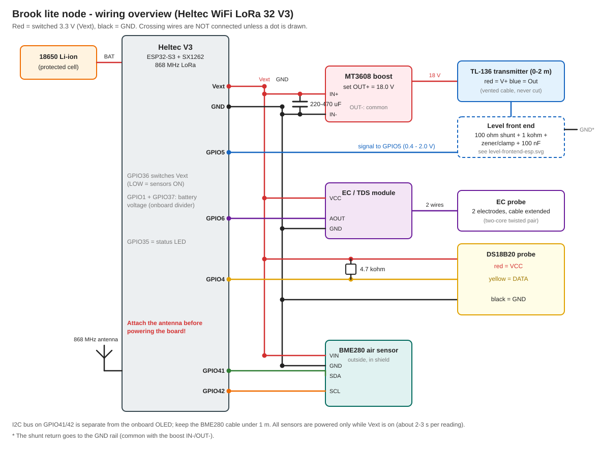
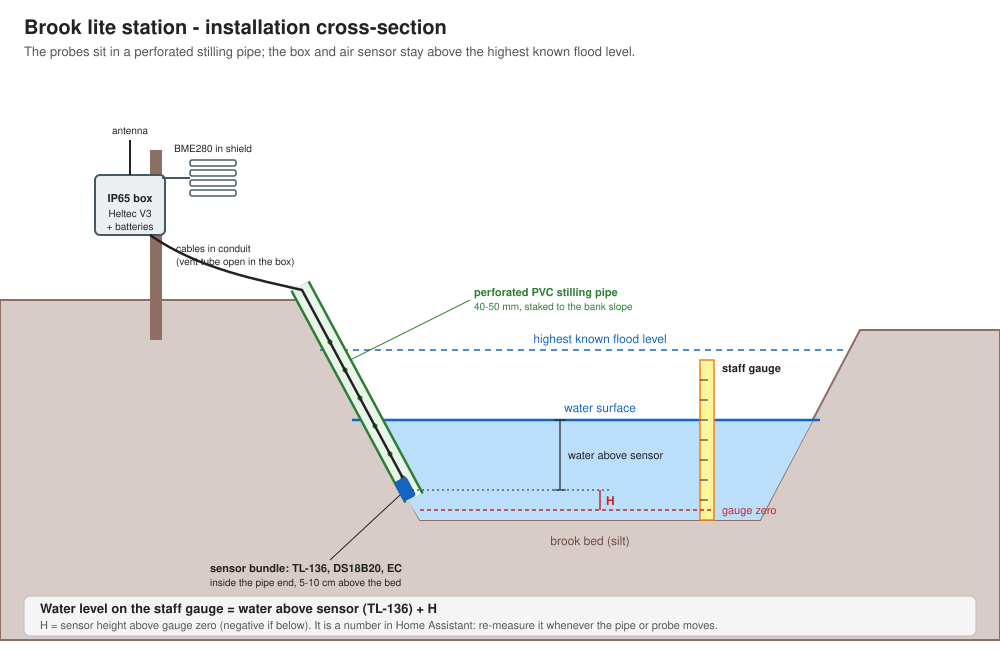

# De Meetbeek LITE: simple citizen-science brook station (ESP32 + LoRa)

> **This is the `lite` branch**: a smaller first step towards the full station on `main`.
> It measures **water level** (TL-136, 0-2 m), **water temperature** (DS18B20), **electrical conductivity** (DFRobot SEN0244)
> and **air temperature, humidity and pressure** (BME280). No ADS1115, turbidity sensor, ultrasonic sensor or air-quality node.

The hardware and firmware are the same design as the groundwater lite version (`geert2/Groundwater-citizen-science-sensors-with-Lora-and-Home-Assistant-`, branch `lite`), adapted to a brook:

* **0-2 m level sensor:** a brook changes at most about 2 m, so a smaller range gives finer resolution.
* **Every 10 minutes** instead of every hour, because a brook reacts to rain within hours.
* **Level on the staff gauge** instead of depth below ground.
* **Stilling pipe** on the bank instead of a piezometer.

A battery-powered node at the brook sends its readings over raw LoRa (869.525 MHz) to a gateway at home that feeds **Home Assistant** and the public **openSenseMap** map.

> **Status:** the ESPHome configs validate and compile (ESPHome 2026.11); CI re-checks both on every push. They have **not yet been tested on hardware**. Bench-test the node first (see the field guide).

---

## What it measures

| Quantity | Sensor | Where | Unit |
| :-- | :-- | :-- | :-- |
| Water level | TL-136 submersible pressure transmitter (0-2 m, 4-20 mA, vented cable) | in a stilling pipe | m on the staff gauge |
| Water temperature | waterproof DS18B20 | bundled with the TL-136 | °C |
| Electrical conductivity (EC25) | DFRobot SEN0244 analog TDS/EC probe, temperature-compensated with the DS18B20 | bundled with the TL-136 | µS/cm |
| Air temperature | BME280 | radiation shield on the bank | °C |
| Air humidity | BME280 | radiation shield on the bank | % RH |
| Air pressure | BME280 | radiation shield on the bank | hPa |
| Battery voltage *(diagnostic)* | onboard divider | node | V |

What to expect: trustworthy **trends and events** (a storm raising the level and diluting the EC, a warm spell), not laboratory accuracy. The level is good to about 1-3 cm after checking against the staff gauge; EC is ±10 % of full scale [R19].

## Key features
* **Level against the staff gauge:** the gateway adds an editable *Sensor Height Above Gauge Zero* to the measured water above the sensor. If the probe moves, you change one number in Home Assistant; no reflashing.
* **Flood and low-water flags:** *Level Above Sensor Range* (beyond 2 m) and *Sensor Dry*.
* **Battery life:** sensors are only powered while measuring. Expect roughly **6-9 months** on 2 × 18650 in parallel at a 10-minute cycle; **measure it** (field guide, section 6). The solar kit from `main` can be added for year-round operation.
* **Low-battery behaviour:** below 3.4 V the node only reports its battery voltage and sleeps 2 h.
* **Simple hardware:** two analog channels (level, EC), one 1-Wire probe, one I²C module.

---

## Repository structure

```text
├── README.md                       # This file
├── BOM.md                          # Shopping list (~€135-195 per station)
├── LICENSE.txt                     # MIT
├── .gitignore                      # Excludes secrets.yaml and build caches
├── .github/workflows/
│   └── esphome-validate.yml        # CI: validates and compiles the ESPHome configs
├── docs/
│   ├── field-guide.md              # Splicing, bench test, calibration, installation, troubleshooting, power
│   ├── wiring.md                   # Level channel, power, EC, BME280, pinout
│   ├── img/                        # Wiring and installation diagrams (SVG)
│   ├── REFERENCES.md               # Sources for technical claims
│   └── CHANGES.md                  # Change log
├── esphome/
│   ├── secrets.yaml.example        # Template for Wi-Fi, keys, sensor height & openSenseMap IDs
│   ├── sync-secrets.sh             # Copies secrets.yaml next to every config
│   ├── gateway/
│   │   ├── brook-lite-gateway.yaml # LoRa receiver + openSenseMap uploader
│   │   └── station-package.yaml    # Everything for ONE station (reusable)
│   └── nodes/
│       ├── common-brook-node.yaml  # Shared node firmware
│       └── brook-lite-node-1.yaml  # Node settings & calibration
└── home-assistant/
    ├── dashboard-card.yaml         # Lovelace card
    └── README.md
```

---

## Quickstart

### 1. Parts & hardware
* Follow **[`BOM.md`](BOM.md)**.
* Build the level-channel front end as in **[`docs/wiring.md`](docs/wiring.md)**: **100 Ω shunt**, 1 kΩ series resistor, 3.6 V zener clamp and 100 nF capacitor. The clamp protects the ESP32-S3 if the transmitter fails short onto its 18 V supply.
* Extend and waterproof the DS18B20 and EC probe cables as in **section 1 of the [field guide](docs/field-guide.md)**.



#### Heltec V3 pinout

| Component | Pin / wire | Heltec V3 pin | Notes |
| :--- | :--- | :--- | :--- |
| **MT3608 boost input** | `VIN+` / `VIN-` | `Vext` / `GND` | Switched by `GPIO36` (`LOW` = ON). Tune output to **18.0 V**. 220-470 µF low-ESR capacitor across its input. |
| **TL-136 level probe** | Red (`V+`) / Blue (`Out`) | MT3608 `VOUT+` / shunt node | **100 Ω 0.1 % shunt** from `Out` to `GND`; shunt node through **1 kΩ** to `GPIO5`. |
| **EC module** | `+` / `-` / `A` | `Vext` / `GND` / `GPIO6` | Module in the dry box, only the two-wire probe in the brook. |
| **DS18B20 water temp** | Red / Black / Yellow | `Vext` / `GND` / `GPIO4` | **4.7 kΩ pull-up** between `Vext` and `GPIO4`. |
| **BME280 air sensor** | `VIN` / `GND` / `SDA` / `SCL` | `Vext` / `GND` / `GPIO41` / `GPIO42` | 3.3 V module, address `0x76` (or `0x77`, set `bme280_address`). In a radiation shield outside the box, cable < 1 m. |

*`GPIO1` reads the battery. The divider is enabled by `GPIO37`: **LOW on V3/V3.1, HIGH on V3.2** (`vbat_ctrl_active_low`, see `docs/wiring.md`). `GPIO35` is the status LED.*

### 2. Register the station on openSenseMap
1. Create a free account at **openSenseMap.org** and click **New senseBox**.
2. Place the marker at the brook and add six custom sensors:
   * **Water Level** (unit `m`)
   * **Water Temperature** (unit `°C`)
   * **Electrical Conductivity** (unit `µS/cm`)
   * **Air Temperature** (unit `°C`)
   * **Air Humidity** (unit `%`)
   * **Air Pressure** (unit `hPa`)
3. Copy the **senseBox ID**, the **access token** and the six **sensor IDs**.

### 3. Configure & flash
1. Copy `esphome/secrets.yaml.example` to `esphome/secrets.yaml` and fill it in.
2. Run `esphome/sync-secrets.sh` (ESPHome only reads `secrets.yaml` from the folder of the config it builds).
3. **Gateway:** `esphome run esphome/gateway/brook-lite-gateway.yaml` on the indoor Heltec V3 via USB-C.
4. **Node:** `esphome run esphome/nodes/brook-lite-node-1.yaml`. The node sleeps right after each reading: hold **BOOT** while pressing **RST** to re-flash over USB later.

### 4. Calibrate & install
Follow the **[field guide](docs/field-guide.md)**: zero and span the level channel, do the two-point EC calibration (84 and 1413 µS/cm), fix the stilling pipe, place the probes, measure the **sensor height above gauge zero**, fit the TL-136 vent tube to a breathable enclosure vent, and mount the BME280 in its shield. **Ask the waterway manager for permission first.**



### 5. Home Assistant
1. Adopt `brook-lite-gateway` under **Settings > Devices & Services > ESPHome** (use the `api_encryption_key`).
2. Paste `home-assistant/dashboard-card.yaml` into a manual card (check the entity IDs first).

---

## Changing the measuring interval
Set `sleep_minutes` in `esphome/nodes/brook-lite-node-1.yaml` (default `"10"`) and `offline_after_ms` in the gateway to about 3.5 × the cycle. A 5-minute cycle roughly halves the battery life.

## Adding a second station
1. Duplicate `esphome/nodes/brook-lite-node-1.yaml` with a new `node_name`.
2. Add `station_2_*` entries to `esphome/secrets.yaml`.
3. In `esphome/gateway/brook-lite-gateway.yaml` add an `s2_*` substitution block, a provider under `packet_transport:` and a package entry under `packages:` (copy the station 1 lines, give it its own `st_label`).

## Relation to the full station (`main`)
The full station adds turbidity, an ultrasonic level cross-check, an ADS1115, solar power, quality flags and a separate air-quality node (PM2.5/PM10). Its node and gateway use a different radio protocol, so a lite node needs the lite gateway. Both use 869.525 MHz and can share the band; at these low duty cycles collisions are rare.

## Sources
See **[`docs/REFERENCES.md`](docs/REFERENCES.md)**.

## Known limitations
* Duty cycle: 144 frames per day at about 0.3 s each is roughly 0.05 % airtime, far below the 10 % limit of the 869.4-869.65 MHz sub-band.
* One transmission per cycle, no acknowledgement: a lost frame is a lost reading (*Node Online* shows longer outages).
* `packet_transport` encryption is a shared passphrase without authentication.
* Level accuracy with the ESP32 ADC is about 1-3 cm after calibration. Floods above 2 m are flagged, not measured.
* The analog EC sensor is only meaningful up to about 2000 µS/cm and has roughly ±10 % of full scale accuracy [R19]: good for trends, not lab values. Algae and silt on the probe shift the reading: clean it monthly.
* The BME280 is ±1 °C / ±3 % RH / ±1 hPa [R24]; without a proper radiation shield the air temperature reads too high in the sun.
* Li-ion cells must not be charged below 0 °C (relevant if you add solar).

## Licence
MIT. Contributions and field reports are welcome.
