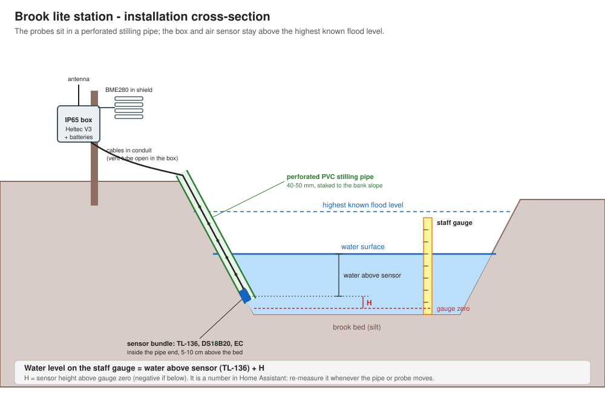

# Field Deployment & Calibration Guide (BROOK LITE)

*`[R#]` tags refer to [REFERENCES.md](REFERENCES.md).*

This guide walks volunteers through waterproofing the submerged sensor cables, bench-testing, calibrating, installing, and maintaining a brook lite station (water level, water temperature, EC, air temperature, humidity and pressure).

> **Before you start:** a brook belongs to a waterway manager (in Flanders VMM, the province, or the municipality/polder, depending on the watercourse category). Ask permission before fixing anything in or on the bank. Never work in the water alone, and never during high water.

---

## 1. Waterproofing Submerged Cable Splices
The TL-136 level probe comes with a 5 m+ factory-sealed **vented** cable (order a length that reaches from the pipe end to the box), so **never cut or splice the TL-136 cable** (doing so can block its internal atmospheric vent tube). However, the **DS18B20** and **EC probe** cables are only ~1 m and must be extended to reach the box on the bank (typically 3-5 m) using flexible waterproof rubber cable (such as 3x0.5 mm² H05RN-F).

* The **DS18B20** has three wires (`VCC`, `GND`, `Data`): all three cores are spliced. *(Tip: DS18B20 probes with a 5 m factory cable exist and avoid this splice.)*
* The **EC probe** is two stainless electrodes with **two wires**. Splice only those two (a twisted pair, or screened cable, is best because the signal is high-impedance). The module with `+ / - / A` stays in the dry enclosure.

Because this splice sits underwater, follow the **Marine Triple-Seal Method**:

### Materials Needed
* **3:1 Dual-Wall Adhesive-Lined Heat-Shrink Tubing** (marine-grade; melts internal hot-melt glue when heated, not standard hobby heat-shrink).
* **Self-Amalgamating Silicone/Rubber Tape** (hardware stores like Hubo/Brico).
* **Flexible Rubber Cable** (extension length as needed, typically 3-5 m).

### Step-by-Step Splicing Procedure
1. **Slide tubing on first:** before soldering, slide one large outer piece of adhesive-lined heat-shrink (~10 cm long) onto the main extension cable, plus smaller pieces (~3 cm long) onto each individual inner wire.
2. **Stagger the cuts:** cut the inner wires at slightly staggered lengths (about 1.5 cm apart). This prevents a thick lump and ensures wires cannot short together.
3. **Solder & seal individual wires:** solder each wire pair cleanly, slide the small adhesive-lined heat-shrink over each joint, and shrink until a tiny ring of clear glue oozes out both ends.
4. **Wrap with self-amalgamating tape:** stretch the tape tightly around the entire staggered bundle, overlapping each turn by 50 % and extending 2 cm onto the original outer cable jackets. The tape fuses into a solid rubber block.
5. **Apply outer adhesive heat-shrink:** slide the large 10 cm tube over the rubber-wrapped joint and shrink it from the centre outward until hot-melt glue seals both ends onto the outer jackets.
6. **Submersion bucket test:** before installing the probes in the brook, coil the spliced sections in a bucket of tap water overnight and verify that the EC and temperature readings remain stable.

---

## 2. Pre-Deployment Bench Checklist
Complete these steps indoors before heading out to the brook.

- [ ] **Boost converter:** with a multimeter, verify the MT3608 output reads **18.0 V DC** while `Vext` is active (the node's LED flashes at wake-up; the rail is on for about 2 s per cycle, so use a long `warmup` temporarily or a bench supply).
- [ ] **Shunt and protection:** confirm the **100 Ω shunt**, the **1 kΩ series resistor**, the **3.6 V zener** and the **100 nF capacitor** are wired as in `docs/wiring.md`. Measure the actual shunt value and set `shunt_ohm` if needed.
- [ ] **Boost input capacitor:** 220-470 µF fitted across the MT3608 input.
- [ ] **LoRa antenna attached:** **never power the Heltec V3 without the 868 MHz antenna screwed on**, or you risk damaging the SX1262 amplifier.
- [ ] **LED flash:** at power-on the node's LED flashes once per reading cycle.
- [ ] **First packet:** the gateway log (or Home Assistant) shows readings for the node within a couple of minutes. If nothing arrives, check that both devices use the same `lora_encryption_key`.
- [ ] **Battery reading:** compare *Battery Voltage* with a multimeter; adjust `vbat_scale` if it is off by more than about 2 %.
- [ ] **BME280:** *Air Temperature* and *Air Humidity* plausible (compare with a reference thermometer/hygrometer in the same room: within about 1 °C and 5 % RH). *Air Pressure* within a few hPa of the station pressure from a nearby weather station (not the sea-level value; about 1 hPa less per 8 m of altitude).
- [ ] **DS18B20:** in a glass of water next to a reference thermometer, *Water Temperature* within about 0.5 °C.
- [ ] **EC:** probe in air reads about **0 µS/cm**; in tap water several hundred µS/cm. Then calibrate (section 3.2).
- [ ] **Dry level test:** with the TL-136 hanging in air, *Water Above Sensor* should read **0.00 m (±0.02 m)**. If it is offset, set `zero_offset_m` in the node file to the negative of the reading (see section 3.1).
- [ ] **Silica gel + breather vent:** fit the membrane vent plug on the enclosure and a fresh 10-20 g silica gel pack inside.

---

## 3. Calibration

### 3.1 Level channel: zero and span
Edit the values in `esphome/nodes/brook-lite-node-1.yaml` and re-flash. Check that `range_m` matches the range on the TL-136 label (default 2.0 m).

1. **Zero (in air):** read *Water Above Sensor* with the probe dry. Set `zero_offset_m` to the negative of that reading (reading 0.014 m → `zero_offset_m: "-0.014"`).
2. **Span (in water, optional but recommended):** hang the probe in a tall container (a pipe or a deep bucket) at two known water heights above the sensor, e.g. 0.30 m and 1.50 m measured with a ruler (a 2 m length of 110 mm PVC pipe with an end cap works well). Note the two readings (with the new zero). Then `span_scale = (1.50 - 0.30) / (reading2 - reading1)`. Typical values are within 0.99-1.01.

3. **Field check:** after installation, compare *Water Level* with the **staff gauge** at every visit. A constant difference means a wrong *Sensor Height Above Gauge Zero* (Home Assistant number entity); a difference that grows with the level means a span error.

*For faster testing on the bench, temporarily set `sleep_minutes: "1"` in the node file.*

### 3.2 EC sensor: two-point calibration
Cheap analog EC/TDS probes vary from batch to batch, and the longer cable changes the response. Calibrate each probe *after* extending its cable. Set `ec_gain: "1.0"` and `ec_offset: "0.0"` first so you read the raw value.

1. **Rinse & dry:** rinse the probe tips with distilled water and blot dry.
2. **Low standard:** place the **EC probe and the DS18B20** in **84 µS/cm** solution; swirl to remove air bubbles; wait 60 s. Trigger a reading (press **RST** once) and note the reported *Electrical Conductivity* as `M1`.
3. **High standard:** rinse and repeat with **1413 µS/cm**, giving `M2`.
4. **Calculate:**
   `ec_gain = (1413 - 84) / (M2 - M1)`
   `ec_offset = 84 - ec_gain × M1`
5. Put both numbers in the node file, re-flash, and verify that both standards now read correctly.

*Single-point fallback (only 1413 µS/cm available):* `ec_gain = 1413 / M`, `ec_offset = 0`. This is less accurate, especially at low conductivity.

Note: the DFRobot analog sensor is specified for 0-1000 ppm TDS (about 0-2000 µS/cm at the usual 0.5 factor) with an accuracy of ±10 % of full scale at 25 °C [R19]. Treat readings above that range as "high", not as precise numbers, and expect a few hundred µS/cm of uncertainty even after calibration.

### 3.3 Temperature, humidity and pressure: sanity check
The DS18B20 (±0.5 °C) and the BME280 (±1 °C, ±3 % RH, ±1 hPa [R24]) need no calibration. Check them once on the bench against a reference (see section 2). If one is consistently off, you can add an offset filter to that sensor in `common-brook-node.yaml` (ESPHome `filters: - offset: -0.4`).

---

## 4. Brook Installation Procedure

### Step 1: Choose the spot
* A straight, stable stretch with water all year, away from the outside of a bend (erosion) and from weirs or culverts (local level jumps).
* Next to an existing **staff gauge**, or place one: a level reference is the only way to check the sensor.
* Where the bank is easy and safe to reach, and the box can stand **above the highest known flood level** with line of sight towards the gateway.

### Step 2: Fit the stilling pipe
1. Use a 40-50 mm PVC pipe, drilled with 8-10 mm holes every 5-10 cm (or a slotted drainage pipe), and a perforated end cap.
2. Lay it along the bank slope (or fix it vertically to a post driven into the bed) with **two or more stainless clamps on stakes**, so a flood cannot move it. The pipe calms the waves and protects the probes from debris.
3. The lower end must stay **under water at the lowest summer level** and **5-10 cm above the bed**, so silt does not bury the probes.
4. Run the cables from the top of the pipe to the box in a **conduit** (protects against mowing, rodents and floating debris).

### Step 3: Bundle and place the sensors
1. Lay the **TL-136**, **EC probe** and **DS18B20** side-by-side so their sensing tips are at the same height.
2. Secure them with **two UV-resistant zip ties** around the stainless body of the TL-136. *(Do not cover the perforated end cap of the TL-136 or the metal pins of the EC probe. Keep the EC electrodes a few cm clear of the TL-136 body.)*
3. Pull the bundle down the pipe on a **stainless wire or Kevlar line** and fix the line at the top of the pipe, so the position is repeatable after cleaning. The line carries the force, **not the cables** (stretching can damage the TL-136 vent tube).

### Step 4: Measure the sensor height (H)
1. On a calm day, read the staff gauge (`G`, in m) and, at the same moment, *Water Above Sensor* in Home Assistant (`W`).
2. **Sensor Height Above Gauge Zero (H) = G - W.** A negative value is fine (sensor below gauge zero).
3. Enter H in Home Assistant under the gateway device as **"Brook Sensor Height Above Gauge Zero"**. The value in `secrets.yaml` is only the starting value; changing the number in Home Assistant needs no reflashing.
4. Repeat on a second visit at a different level. If H differs by more than about 1 cm, check the span (section 3.1).

### Step 5: Mount the enclosure and air sensor
1. Fix the post on the bank and the IP65 box on it, **above the highest known flood level** (look for debris lines, ask locals).
2. Pass the TL-136, DS18B20 and EC probe cables through the waterproof **PG9/PG11 cable glands** at the bottom of the box and tighten them firmly.
3. **Critical vent tube check:** the TL-136 cable has a tiny clear hollow tube alongside the wires. Make sure it is **not pinched, kinked, or sealed** with glue or heat-shrink. It must end freely **inside the box** next to the desiccant, and the box needs the **membrane vent plug** so its air pressure follows the atmosphere. If the vent tube ever gets flooded, the level reading becomes wrong.
4. **Air sensor:** mount the radiation shield with the BME280 on the shaded (north) side of the post, ideally about 1.5 m above ground, and route its cable (≤ 1 m, drip loop downwards) through the fourth gland.
5. Connect the batteries, check that the LED flashes at wake-up, and close the lid.
6. Check that the gateway receives the first packet before you leave the site.

---

## 5. Field Troubleshooting Matrix

| Symptom | Likely Cause | Field Fix |
| :--- | :--- | :--- |
| **Level reads `unavailable`** | Shunt current outside 3.5-22 mA (0.35-2.2 V across 100 Ω). | Check battery charge, MT3608 output (18 V), and the red/blue wires and the shunt/zener network. |
| **Level differs from the staff gauge by a constant amount** | Wrong zero or sensor height, or the pipe/probe has moved (flood!). | Redo Step 4 of section 4; correct *Sensor Height Above Gauge Zero*. |
| ***Sensor Dry* is on** | The water has dropped to or below the probe. | Genuine very low flow, or the probe sits too high or was lifted out by a flood. Lower the pipe end if possible. |
| ***Level Above Sensor Range* is on** | Flood above the 0-2 m range. | The real level is higher than shown; read the staff gauge. Consider a larger range if it happens often. |
| **Level jumps or is noisy** | Waves or turbulence reach the sensor; holes in the pipe too large. | Fit a finer-perforated pipe or wrap it in geotextile; move away from riffles. |
| **Level drifts slowly with the weather** (follows *Air Pressure*) | Vent tube blocked or wet; sealed enclosure. | Open the box, check the tube, fit/clean the breather vent, replace saturated silica gel. |
| **Water temperature `unavailable`** | DS18B20 disconnected, water in the splice, or missing 4.7 kΩ pull-up. | Check `GPIO4` wiring, the splice and the pull-up. |
| **EC reads erratically or spikes after submerging** | Water in the cable splice, mud or algae on the prongs, or silt in the pipe. | Pull up, inspect the splice, re-seal, clean the prongs, flush the pipe. |
| **EC drops sharply after rain** | Usually real: rain water dilutes the brook. | Compare with the level: a rising level with falling EC is a normal storm response. |
| **EC reads too low or too high everywhere** | Uncalibrated probe or longer cable. | Redo 3.2. |
| **EC always 0** | Module not powered, `A` not on `GPIO6`, or probe out of the water. | Check the module wiring and the probe depth. |
| **Air temperature / humidity / pressure `unavailable`** | Wrong address, loose or too long I²C cable, or a BMP280 (no humidity). | Check `GPIO41/42`, try `bme280_address: "0x77"`, shorten the cable or add 4.7 kΩ pull-ups, check the chip. |
| **Air temperature too high on sunny days** | Shield missing, in the sun, or too close to the box. | Move the shield to the shaded side, use a louvred shield. |
| **No data from a node** | Out of range, loose antenna, key mismatch, or flat battery. | Check the antenna, move the gateway closer to a window, verify `lora_encryption_key` is identical everywhere, check the battery. |
| **Gateway shows *Node Online = off*** | No packet for 35 min. | Same as above; also look for a battery below 3.4 V (the node then sends only its voltage every 2 h). |
| **Battery reads 0 V or nonsense** | `GPIO37` polarity (depends on the board revision: V3/V3.1 LOW, V3.2 HIGH) or wrong divider factor. | Set `vbat_ctrl_active_low` for your revision (see `docs/wiring.md`, "Board revision check"); adjust `vbat_scale` against a multimeter. |
| **Data in Home Assistant but not on openSenseMap** | Wrong box ID, sensor ID or token. | Check the gateway log for *openSenseMap upload failed* and the HTTP status. The token is sent as-is in the `Authorization` header. |

---

## 6. Power Budget (estimate, verify once per design)
A brook reacts to rain within hours, so the node measures every **10 minutes** (`sleep_minutes: "10"`; the groundwater version uses 60). That makes the awake time, not the sleep current, the main consumer.

| Item | Estimate |
| :-- | :-- |
| Awake per cycle | about 3.5 s (boot, 0.7 s warm-up, 0.9 s DS18B20, 1.5 s radio) |
| Current while awake | about 100-130 mA (ESP32 + 18 V boost for the TL-136 loop + EC module) |
| Energy per cycle | about 0.1-0.13 mAh |
| Sleep current | 0.05-0.2 mA (Heltec V3 board; measure it) |
| **Per day, 10-minute cycle** | **about 17-25 mAh** |
| Per day, 5-minute cycle | about 32-45 mAh |

* 2 × 3000 mAh in parallel (about 4800 mAh usable) lasts roughly **6-9 months** at 10 minutes, or **3-5 months** at 5 minutes.
* For year-round operation without swapping batteries, add the solar kit described on the `main` branch (panel + CN3791 MPPT charger).
* Measure it: put a µA-capable meter in series with the battery for the sleep current, and time the awake phase with the LED. If the TL-136 settles faster, shorten `warmup`.
* Estimate: mAh per day = active mA × active s ÷ 3600 × readings per day + sleep mA × 24.

---

## 7. Volunteer Maintenance
* **After every flood:** check that the pipe and the post are still in place and re-check the level against the staff gauge (Step 4 of section 4). Remove debris caught on the pipe.
* **Monthly:** pull the bundle up, rinse algae, silt and biofilm off the EC prongs, the TL-136 nose cone and the DS18B20 with brook or clean water, and flush the pipe. Read the staff gauge and note the difference from *Water Level*.
* **Spring & Autumn:** open the junction box, swap the silica gel (there is no humidity sensor inside the box in the lite version, so do this on schedule), check the breather vent, and check battery voltage on the dashboard (recharge or replace below **3.4 V**).
* **Once per year:** inspect zip ties, the line, the cable splices and the conduit. Do not scrub the TL-136 diaphragm with brushes or sharp tools.
* **EC probe:** check against a handheld EC meter every 3 months, recalibrate yearly, and replace when it will not hold calibration.
* **Radiation shield:** remove spider webs and insects, which disturb the humidity reading.
