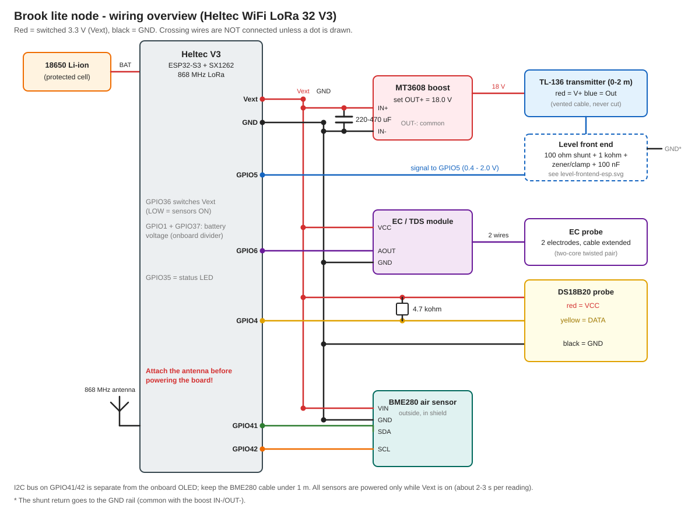
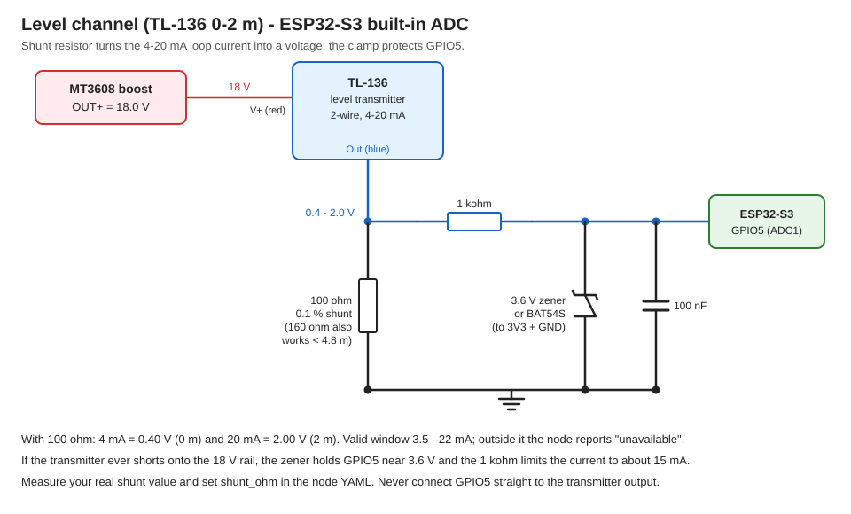

# Wiring Notes (BROOK LITE): Level Channel, Power, EC, BME280 and Pinout

*`[R#]` tags refer to [REFERENCES.md](REFERENCES.md).*

> Not yet tested on hardware. Build one node on the bench and check every voltage before putting the transmitter in the brook.

## Overview: whole node



*Red = switched 3.3 V (`Vext`), black = GND. Crossing wires are not connected unless a dot is drawn. Diagram sources are plain SVG files in `docs/img/`.*

## 1. Level channel (TL-136 0-2 m, 4-20 mA loop)




* Use a TL-136 with a **0-2 m** range: a brook rarely changes more than about 2 m, and a smaller range gives finer resolution (16 mA over 2 m, 0.8 mV per mm across 100 Ω). Set `range_m` in the node file (and in the gateway package) if yours differs.
* Voltage across the shunt: 4 mA = 0.40 V (0 m), 20 mA = 2.00 V (2 m). This stays inside the ESP32-S3 ADC range, unlike 160 Ω (3.2 V).
* A flood above the range drives the loop slightly above 20 mA (up to the transmitter's limit, typically about 21-22 mA): the node still reports it, and the gateway sets *Level Above Sensor Range*. Most TL-136 units tolerate 1.5-2× their range as overpressure; check your datasheet.
* The **1 kΩ + zener** protect `GPIO5`. If the transmitter fails short onto the 18 V rail, the zener clamps the pin near 3.6 V and the 1 kΩ limits the current (about 15 mA). Without them an ESP32-S3 pin would see up to 18 V.
* Check the zener's leakage near 2 V (should be negligible). If the reading at 20 mA is more than about 10 mV low, use a TVS or a BAT54S Schottky clamp (one diode to `GND`, one to `3V3`) instead.
* The firmware converts the shunt voltage to current with `shunt_ohm` (default 100.0). Measure your actual resistor and set `shunt_ohm: "100.3"` (for example) in the node file.
* **Valid range:** 3.5 mA to 22 mA. Outside it the node reports *unavailable* (broken wire, short, boost fault).

### Accuracy note
The ESP32-S3 ADC reads up to about 3.1 V at 12 dB attenuation [R17] and its reference voltage varies between 1000 and 1200 mV from chip to chip [R16]. In practice that means tens of mV of error, roughly 1-3 cm of water with the 0-2 m sensor. The zero and span calibration against the staff gauge removes most of it. If you need better, the full station on the `main` branch uses an ADS1115.

### Using a 160 Ω shunt instead
The full station on `main` uses 160 Ω with an ADS1115. With the ESP32 ADC, 160 Ω saturates near 19.5 mA (about 3.1 V [R17][R3]), which is about 1.94 m on a 0-2 m sensor, and floods would no longer be visible. Keep 100 Ω for the lite node.

## 2. Power

```text
2 x 18650 in parallel --> Heltec battery connector --> 3.3 V regulator --> Vext switch (GPIO36 LOW = ON)
                                                              |
                          +-----------------------------------+--------------+--------------+
                          |                                   |              |              |
                  [220-470 uF] + MT3608 IN                 BME280       EC module      DS18B20 (+4.7 k pull-up to GPIO4)
                          |
                      MT3608 OUT = 18.0 V  --> TL-136 V+
```

* **Battery:** two protected 18650 cells **in parallel** (never in series; the Heltec charges one cell). The 10-minute cycle uses roughly 17-25 mAh per day (field guide, section 6), so 2 × 3000 mAh lasts about 6-9 months. For a 5-minute cycle or year-round operation without battery swaps, add the small solar kit described on `main` (panel + CN3791 MPPT charger).
* Li-ion must **not be charged below 0 °C**. With solar, use a charger with a temperature cut-off or accept that winter charging stops on frosty days.
* The 220-470 µF capacitor at the boost input is a precaution against the start-up current spike browning out the ESP32. The MT3608 has internal soft start [R20], so this is a cheap safeguard rather than a fix for a known fault.
* The TL-136 is listed with a 12 to 32 V supply [R21]; at 18 V a 160 Ω shunt (3.2 V at 20 mA) still leaves about 14.8 V. Check the label of your unit.
* Set the MT3608 to 18.0 V **before** connecting the TL-136, and re-check after transport (the trimmer drifts).
* `Vext` is switched on very early at boot (before the sensors are set up), because the BME280 and DS18B20 are detected once during start-up and must already have power.
* Active energy is dominated by the boost converter. Keep the `warmup` time as short as the transmitter allows (measure how fast the reading settles).
* **Optional improvement (not in the firmware):** switch the boost converter with its own MOSFET so the EC and temperature probes can be read while the 18 V loop is off. This removes possible stray current in the water and saves energy.

## 3. Pin summary

| Function | Heltec V3 pin | Notes |
| :--- | :--- | :--- |
| Vext enable | `GPIO36` | LOW = sensor rail ON |
| Level signal | `GPIO5` (ADC1) | via 1 kΩ, zener, 100 nF |
| EC signal | `GPIO6` (ADC1) | analog output of the DFRobot EC/TDS module (0-2.3 V) |
| DS18B20 data | `GPIO4` | 4.7 kΩ to `Vext` |
| BME280 SDA / SCL | `GPIO41` / `GPIO42` | separate I²C bus from the onboard OLED, 50 kHz; powered from `Vext` |
| Battery ADC | `GPIO1` | divider 390 k / 100 k (factor 4.9) |
| Battery divider enable | `GPIO37` | V3 / V3.1: **LOW** connects the divider; **V3.2: HIGH** [R11][R13]. Set `vbat_ctrl_active_low` |
| Status LED | `GPIO35` | flashes once at every wake-up |
| LoRa SX1262 | `GPIO8/9/10/11/12/13/14` | onboard; `tcxo_voltage: 1_8V`, `rf_switch: true` |

Check the battery reading against a multimeter once. If it is off, adjust `vbat_scale` in the node file (default 4.9; a 390 k / 100 k divider [R12], while ESPHome's device page uses 2.0 [R10]).

### Board revision check (do this once per board)
The polarity of two pins differs between Heltec V3 revisions, and the firmware has two settings for it:

| Setting in the node file | V3.0 / V3.1 | V3.2 | Source |
| :-- | :-- | :-- | :-- |
| `vbat_ctrl_active_low` (GPIO37) | `"true"` | `"false"` (default) | [R11] [R13] |
| `vext_active_low` (GPIO36) | `"true"` (default) | **not confirmed**, check | [R10] [R11] [R14] |

1. Read the revision printed on the board (V3.2 is the current one).
2. Battery: with the battery connected and the node awake, *Battery Voltage* should match a multimeter within a few percent after adjusting `vbat_scale`. A reading near 0 V means the polarity is wrong (the firmware then ignores the reading and carries on measuring).
3. Vext: measure between the `Ve` pin and `GND` while the node is awake (it switches `Vext` on in early boot). About 3.3 V means the setting is right. If it reads 0 V, flip `vext_active_low`. Compare with the V3.2 schematic [R14] if in doubt.
4. A cleaner test: flash a minimal config that only toggles `GPIO36` and `GPIO37` from two buttons or switches, and watch the voltages.


## 4. Enclosure
* Mount the box on a post **above the highest flood level you know of** (ask locals, look for debris lines on the bank). Only the probes may get wet.
* The TL-136 vent tube must reach **atmospheric pressure**. A sealed box warms in the sun and changes its internal pressure (1 hPa is about 1 cm of water). Fit a **membrane vent plug** to the enclosure and keep the vent tube open inside it, together with a desiccant packet.
* Never put the antenna's U.FL connector in contact with water; **never power the board without the antenna attached**.

## 5. EC sensor (DFRobot SEN0244 Gravity analog TDS/EC)
* The **module** (`+` / `-` / `A`) stays in the dry enclosure: `+` to `Vext`, `-` to `GND`, `A` to `GPIO6`. Only the two-wire **probe** goes into the brook.
* The module runs on 3.3-5.5 V and outputs 0-2.3 V [R19], well inside the ADC range at 12 dB attenuation. It is powered from `Vext`, so it only excites the probe for the second or so of a reading. The module drives the probe with AC, which avoids electrolysis of the electrodes.
* Extend the probe cable with a **two-core twisted pair** (or screened cable); the probe signal is high-impedance and picks up noise. Waterproof the splice as in section 1 of the field guide.
* Fix the probe in the stilling pipe at the same height as the DS18B20, which provides the temperature compensation (2 %/°C to 25 °C), and keep the electrodes **a few cm clear of the TL-136 body**.
* The firmware converts the voltage with DFRobot's cubic curve and then applies `ec_gain` / `ec_offset` from the two-point calibration (field guide, section 3.2). Readings are only meaningful up to about 2000 µS/cm. A Flemish lowland brook is typically a few hundred to about 1000 µS/cm.

## 6. BME280 (air temperature, humidity and pressure)
* Wire `VIN` to `Vext`, `GND` to `GND`, `SDA` to `GPIO41`, `SCL` to `GPIO42`. It is powered only during a reading, which also avoids self-heating.
* Mount it **outside the enclosure in a radiation shield** (a small louvred Stevenson-type shield, or a stack of white plant saucers), ideally 1.5 m above ground, above flood level, and on the shaded north side of the post. Without a shield, direct sun makes the air temperature read several degrees too high.
* Use a 4-core cable of **at most about 1 m** through its own cable gland. I²C is meant for short distances; the firmware runs the bus at 50 kHz to tolerate the extra cable capacitance. Most breakouts already have 10 kΩ pull-ups on SDA/SCL; if readings drop out with a longer cable, add 4.7 kΩ pull-ups from SDA and SCL to `Vext` at the Heltec side.
* Seal the cable entry of the shield loosely (drip loop downwards); the sensor itself must stay in free air, not in a sealed box, or the humidity reading follows the box instead of the weather.
* Many cheap modules sold as "BME280" are really BMP280 (no humidity). If *Air Humidity* stays unavailable, check the chip marking.
* If the module's address pin is wired high the address is `0x77`; set `bme280_address: "0x77"` in the node file.
* Accuracy is about ±1 °C, ±3 % RH and ±1 hPa [R24]. Air pressure is not needed for the level (the TL-136 is vented), but it helps to interpret the data: falling pressure announces rain, and it lets you check the vent tube (a level that follows the pressure means a blocked vent).
* Long exposure to near-100 % RH (fog, dew, common next to a brook) can cause a temporary offset that recovers in dry weather.
* Because the BME280 is outside, the lite version has no humidity reading inside the box: replace the silica gel on a fixed schedule (spring and autumn).
