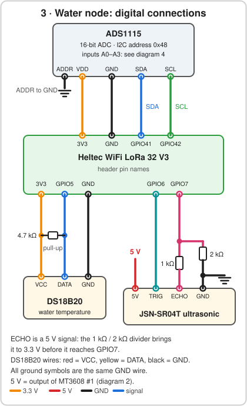
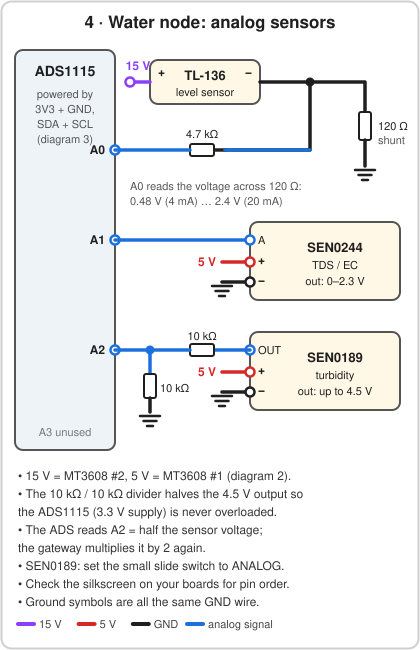
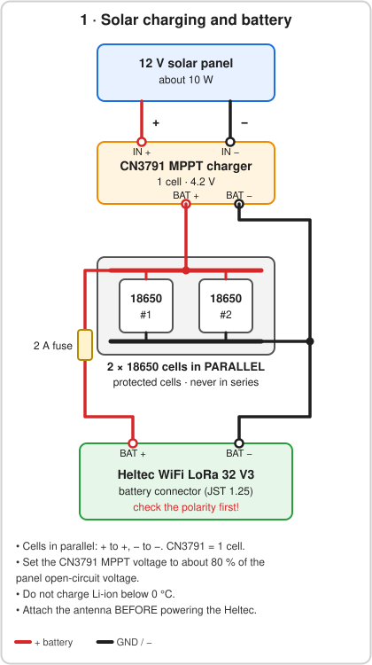
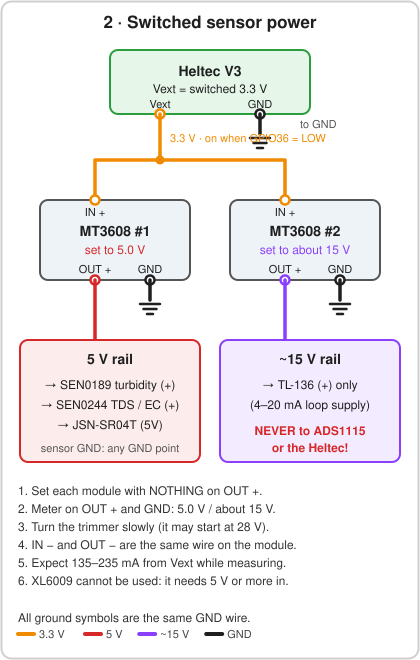
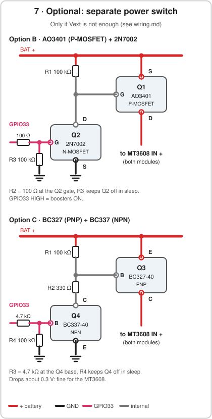
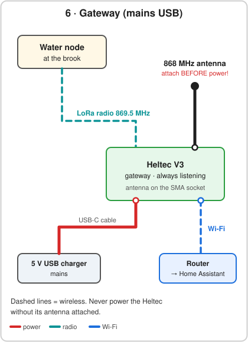
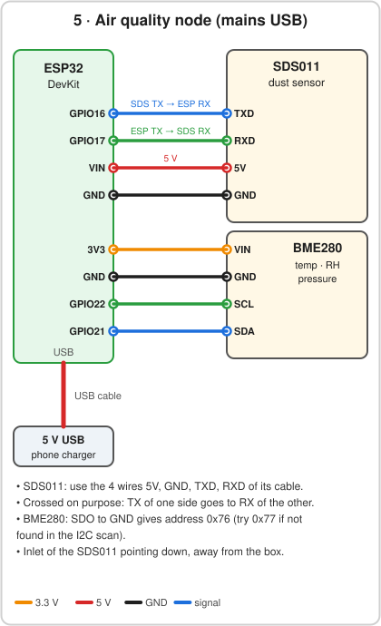

# Wiring

Pictures for every connection are included below (diagrams 1–7, source in `img/src`). Read the text next to each picture too: it explains the part values and the safety notes.

> **Check before you solder.** The pin numbers below follow the Heltec WiFi LoRa 32 **V3**
> (ESP32-S3). Board revisions differ slightly (V3, V3.1, V3.2). Compare with the pinout
> diagram that belongs to *your* board, and bench-test each sensor on its own
> (see [bench-test.md](bench-test.md)) before putting everything in the box.

## 1. Pin plan: water node (Heltec V3)

The ESP32-S3 has **no** GPIO22, 25, 32, 34 or 35 that can be used for this, which is why the
original pin list (written for a classic ESP32) did not work.

### Used by the board itself, do not use

| GPIO | Function |
|------|----------|
| 8, 9, 10, 11, 12, 13, 14 | SX1262 LoRa radio (NSS, SCK, MOSI, MISO, RST, BUSY, DIO1) |
| 17, 18, 21 | on-board OLED (not used in this project) |
| 1 | battery voltage sense (ADC) |
| 37 | enables the battery voltage divider |
| 36 | **Vext** switch: the board's own switched 3.3 V output (LOW = on). Used here to power the boosters |
| 0 | PRG button |
| 35 | on-board LED |
| 19, 20 | USB |

### Proposed external connections



| Function | GPIO | Notes |
|----------|------|-------|
| I2C SDA (ADS1115) | **41** | 16-bit ADC, address 0x48 |
| I2C SCL (ADS1115) | **42** | |
| DS18B20 1-Wire | **5** | 4.7 kΩ pull-up to 3V3 |
| JSN-SR04T trigger | **6** | |
| JSN-SR04T echo | **7** | through a divider (see below) |
| Booster power (15 V + 5 V rails) | **36 (Vext)** | the board's built-in switch, no MOSFET needed (section 3) |
| Spare | 2, 3, 4 (ADC1), 33, 34, 38, 39, 40 | |

The analog sensors are read by an external 16-bit **ADS1115**, not the ESP32's own (noisy) ADC:

| ADS1115 input | Signal |
|---------------|--------|
| A0 | TL-136 loop voltage (across the shunt resistor) |
| A1 | SEN0244 TDS/EC sensor output |
| A2 | SEN0189 turbidity output (after the 2:1 divider) |
| A3 | spare |

The ADS1115 is powered from the permanent 3V3 pin (it idles at under 1 µA), so it is
available at every wake-up.

## 2. Sensor circuits



### TL-136 level sensor (4–20 mA, two wires)

```
~15 V booster out ──► TL-136 (+)
                      TL-136 (−) ──┬──► 120 Ω shunt ──► GND
                                   │
                                   └──► 4.7 kΩ ──┬──► ADS1115 A0
                                                 │
                                   (optional) BAT54S clamp: A0 → GND and A0 → 3V3
```

* Shunt: **120 Ω** (1 % is fine). 4 mA gives 0.48 V and 20 mA gives 2.4 V, well inside the
  ADS1115's ±4.096 V range (it is powered from 3.3 V and must never see more than 3.6 V on an
  input). **Measure the real resistance** with a multimeter and enter it as `tl136_shunt_ohm`
  in the gateway file.
* **Loop supply voltage:** at 20 mA the shunt takes 20 mA × 120 Ω = 2.4 V, so the sensor gets
  the booster voltage minus 2.4 V. With the booster at **15 V** that is **12.6 V at full
  scale**, exactly where the level is highest. There is no authoritative TL-136 datasheet:
  seller manuals list **12–32 V**, so read the label on your unit and treat **12 V as the
  minimum**. Do not set the booster above the sensor's maximum (typically 30 V or more).
  - *Already built with 160 Ω?* Then the sensor gets only 15 − 3.2 = 11.8 V at 20 mA. Either
    swap the shunt for 120 Ω (or 100 Ω) or set the loop booster to about **16 V**. A lower
    shunt costs no extra power; a higher booster voltage adds load on Vext (section 3).
* **Input protection (4.7 kΩ series resistor, optional clamp).** If the shunt breaks open, the
  loop current is pushed into `A0` instead of to ground. The TL-136 limits that current and
  the ADS1115's internal diodes pass it to 3V3, but the 4.7 kΩ resistor keeps it to about
  2–3 mA even in the worst case (15 V booster, sensor shorted), well under the ADS1115's
  10 mA continuous limit. For extra margin, fit a **BAT54S** (dual Schottky, SOT-23): its
  middle pin on `A0`, one end on `GND`, the other on `3V3`. The ADS1115 input impedance
  is several megohms, so 4.7 kΩ adds well under 0.2 % error; a two-point check
  (calibration.md, section 1, step 5) catches it.
* The booster is only on while the node is awake.
* Check whether your TL-136 cable has a **vent tube** (atmospheric reference). Do not seal it;
  use a desiccant cap.
* Set the sensor's range (for example 0–1 m) as `tl136_range_m` in the gateway file.

### DS18B20 water temperature

```
3V3 ──┬── 4.7 kΩ ──┬── GPIO5
      │            │
      └── VCC      DATA        GND ── GND
```

### SEN0244 TDS / EC sensor (DFRobot Gravity analog TDS)

* Connector (Gravity, 3 pins): the board is marked **A, +, −**: signal, supply, ground (in the
  DFRobot cable: blue = signal, red = supply, black = ground).
* Supply: **5 V rail** (3.3–5.5 V allowed, current about 3–6 mA). Signal (0–2.3 V) goes
  straight to **ADS1115 A1**, ground to GND. No divider is needed.
* Measuring range is 0–1000 ppm, which is about 0–2000 µS/cm. That fits a Flemish brook
  (typically several hundred µS/cm). DFRobot quotes an accuracy of ±10 % of full scale,
  so **always calibrate** (see [calibration.md](calibration.md)).
* Only the probe goes into the water. Keep the electronics board and connector dry.
  Check the DFRobot wiki on whether permanent immersion is allowed; if not, mount the probe
  in a small flow-through bypass or lift it out of the water between campaigns.
* Keep the signal cable short and away from the loop wires.
* The part number is **SEN0244**. Please check your package: some shops write it differently.

### SEN0189 turbidity sensor (DFRobot Gravity analog turbidity)

The sensor runs on **5 V** and its output can reach about 4.5 V. That is too high for the
3.3 V-powered ADS1115, so use a divider:

```
Sensor OUT ──► 10 kΩ ──┬──► ADS1115 A2
                       │
                     10 kΩ
                       │
                      GND
```

* Power from the **5 V booster rail** (it draws up to about 40 mA, so it must be switched off
  during sleep).
* The board has a small **slide switch** that selects *analog* or *digital (high/low)* output.
  It is **not** a power switch. Set it to **analog**, and leave the blue trimmer alone (it only
  sets the digital threshold).
* The output voltage **falls** as the water gets cloudier.
* Mount it in a shaded housing (daylight disturbs the optical measurement).

### JSN-SR04T ultrasonic (level, cross-check)

```
5 V rail ──► VCC           Echo ──► 1 kΩ ──┬──► GPIO7
GPIO6 ────► Trig                            │
GND ──────► GND                           2 kΩ
                                            │
                                           GND
```

* The echo pin outputs 5 V, so the 1 kΩ / 2 kΩ divider brings it to about 3.3 V.
* The sensor cannot measure closer than about 25 cm: mount it at least that far above the
  highest water level.
* Mount it in a short PVC stilling tube so that banks, plants and foam do not cause false echoes.

## 3. Power



```
12 V solar panel ──► CN3791 MPPT charger ──► 2 × 18650 (PARALLEL, protected) ──► BAT+
                                                                       │
                           Heltec V3 battery connector ◄───────────────┘   (permanent supply)

   Heltec 3.3 V regulator ──► Vext (switched by GPIO36, built into the board)
                                       │
                    ┌──────────────────┴──────────────────┐
              MT3608 → ~15 V (TL-136 loop)         MT3608 → 5 V (SEN0189, SEN0244, JSN-SR04T)
```

### Rules

* The CN3791 is a **single-cell** charger. Put the two 18650 cells **in parallel (2P)**,
  never in series. Use protected cells or a protection board (DW01 type).
* Add a **2 A fuse** on the battery positive.
* Li-ion must **not be charged below 0 °C**. Mount the cells inside the enclosure, preferably
  in a spot that stays above freezing, or choose a CN3791 board with a temperature cut-off.
* Check the **polarity** of the Heltec battery connector (JST 1.25). Polarity differs between
  boards and sellers, and a wrong plug can destroy the board.
* Set the CN3791 MPPT voltage for your panel (about 80 % of the panel's open-circuit voltage).
* Never power the Heltec without its antenna attached.

### The two boosters: use MT3608, not XL6009

A single Li-ion pack is 3.0–4.2 V. The **XL6009 needs at least 5 V at its input**, so it cannot
work from this battery (it only worked in the old series-cell design). Use two **MT3608**
modules (input 2–24 V), one set to 5 V and one set to about 15 V.

| | MT3608 module |
|---|---|
| Input voltage | 2 V to 24 V |
| Output voltage | adjustable, up to 28 V (set with the small trimmer) |
| Output current | about 0.5 A at 12–15 V from a 3.7 V cell, more at 5 V (plenty for these sensors) |
| Efficiency | about 85–90 % |
| Idle consumption | a few mA, which is why we switch the input off during sleep |
| Cost | about €1 per module |

How to set one:

1. Connect the input to a bench supply or the battery (switch on). **Nothing connected to the output.**
2. Measure the output with a multimeter and turn the trimmer slowly until you read exactly
   5.0 V (or 15 V for the loop booster). The turning direction differs between modules,
   and some modules start at the maximum (28 V!), so never connect a sensor before setting it.
3. Mark the trimmer with a drop of nail polish so it cannot drift.

A boost converter always passes its input to its output through an internal diode, so you
cannot switch the *output* off. That is why the switch sits in front of the **input**.

### Switching the boosters

**Why switch at all?** While the node sleeps, everything must be completely off: the turbidity
sensor alone draws up to 40 mA, and each booster wastes a few mA. The sensor boards
(SEN0189 and SEN0244) have only power, ground and signal pins and **no enable pin**, so
they cannot switch themselves off. The switch has to be external.

### Option A (recommended, no extra parts): use the Heltec "Vext" output



The Heltec V3 already contains a high-side switch for exactly this purpose: **Vext**, a
switched 3.3 V output controlled by **GPIO36** (LOW = on). Heltec specifies **350 mA** for
Vext (V3 datasheet). Connect the **inputs of both MT3608 boosters to the Vext pin** and their
grounds to GND. The firmware already does this (`boost_enable` = GPIO36, inverted).

Current estimate from 3.3 V (the node switches the boosters off before it transmits, so the
radio current never adds to this):

| Load | Power | From 3.3 V (about 75–80 % efficiency) |
|------|-------|---------------------------------------|
| 5 V rail: SEN0189 (≤40 mA) + SEN0244 (3–6 mA) + JSN-SR04T (~10–30 mA) | ~0.3 W | ~110 mA |
| 15 V loop: TL-136 at 4–20 mA | 0.06–0.30 W | ~25–125 mA |
| **Total** | | **about 135–235 mA** |

That stays under 350 mA, but not by a huge margin. Things to check:

* **Board version.** The V3/V3.1 switches the 3.3 V line with a MOSFET. The **V3.2 uses a
  separate small regulator for Vext**. Look up the current rating of that regulator in the
  schematic for your revision.
* **Measure it:** put a multimeter in series with the booster inputs and read the current
  while the node is measuring. If you see random resets (log: "brownout"), the 3.3 V rail is
  sagging and you need Option B or C.
* **Sleep:** measure the voltage on the Vext pin while the node sleeps. It must be 0 V.
* The XL6009 cannot be used here (its minimum input is far above 3.3 V). Use two MT3608.
* Running the boosters from the 3.3 V regulator instead of straight from the battery costs
  about 10 % extra battery energy. That is acceptable.

### Option B: a separate MOSFET switch (new to you? read this)



Use this if Option A is too close to the limit or your Vext gives resets.

**What is a MOSFET?** A transistor with three legs: *Gate* (the control input), *Source* and
*Drain* (the current path). Voltage on the gate decides whether current can flow from source
to drain. It needs almost no current on the gate, and has a very low resistance when on.

* An **N-channel** MOSFET conducts when the gate is *higher* than the source. It is easy to
  drive from a 3.3 V pin, but it normally switches the ground side.
* A **P-channel** MOSFET conducts when the gate is *lower* than the source. It is used on the
  positive side ("high-side"), which is what we need, because the sensors, the ADS1115 and
  the Heltec must all share the same ground.

**The problem:** a P-MOSFET with its source on the battery (up to 4.2 V) cannot be switched off
properly by a 3.3 V pin (the gate would still be 0.9 V below the source). So we add a small
N-MOSFET as a driver:

```
BAT+ ───────────┬────────────────────────────┐
                │                            │ Source
              100 kΩ  (R1)               P-MOSFET  Q1 (AO3401)
                │                            │ Drain ──► + input of BOTH MT3608 modules
                ├──────────── Gate ──────────┘
                │
              Drain
        N-MOSFET  Q2 (2N7002)
              Source ── GND
              Gate ──┬── 100 Ω (R2) ── GPIO33
                     │
                   100 kΩ (R3)
                     │
                    GND
```

How it works:

* **GPIO33 LOW (or asleep):** Q2 is off. R1 keeps the gate of Q1 at battery voltage, so Q1
  is off. The boosters get no power.
* **GPIO33 HIGH:** Q2 conducts and pulls the gate of Q1 down to ground. Q1 is now 3–4 V
  "more negative" than its source and conducts. The boosters are powered.
* **R3** keeps Q2 off when the pin floats (deep sleep, boot). **R2** limits the current
  spike into the gate. **R1** keeps Q1 off by default.

**Parts (all common and cheap, about €1 together)**

| Part | Type | Key specs |
|------|------|-----------|
| Q1 | P-channel MOSFET **AO3401** (or AO3401A, SI2301, similar) | SOT-23, Vds −30 V, Id about −4 A, on-resistance about 50–60 mΩ at Vgs −4.5 V, gate threshold about −0.7 to −1.3 V. It must be a **logic-level** type |
| Q2 | N-channel MOSFET **2N7002** | SOT-23, Vds 60 V, gate threshold 1–2.5 V |
| R1, R3 | 100 kΩ resistor | 1/8 W is enough |
| R2 | 100 Ω resistor | 1/8 W |

* Both transistors come in **SOT-23**, a tiny surface-mount package. Buy them already soldered on
  "SOT-23 to DIP" breakout boards, or buy a ready-made **"P-MOSFET high-side switch" module**
  designed for 3.3 V logic.
* **Do not use the popular IRF520 or "MOSFET driver" modules**: they need a 10 V gate drive and
  do not switch properly from a 3.3 V pin. Also avoid ordinary TO-220 P-MOSFETs (IRF9540):
  they are not logic-level.
* **Orientation:** the P-MOSFET's **source goes to the battery**, its **drain to the boosters**.
  If reversed, an internal diode lets current through and the switch never turns off.
  The pin order of SOT-23 parts differs per manufacturer: check the datasheet of the exact
  part you bought.

**Test before connecting anything else** (battery or 4 V supply, a multimeter, a 1 kΩ resistor):

1. Connect GPIO33 to GND: the voltage at the Q1 drain stays at about 0 V.
2. Connect GPIO33 to 3.3 V: the drain jumps to battery voltage minus 0.1 V or less.
3. Only then connect the MT3608 inputs.


**Can't find the parts?** The usual problem is that the SOT-23 transistors are sold bare. Search
for **"SOT23 to DIP adapter"** or **"SOT-23 breakout PCB"** (packs of 10 cost about €1) and solder
the transistor onto it, or buy the P-MOSFET together with such a breakout. Common search terms
for the transistors themselves: "AO3401 SOT-23", "2N7002 SOT-23".

Using Option B in the firmware: in `brook_sensor_node.yaml` change the `boost_enable` pin from
`GPIO36` (inverted) to `GPIO33` (not inverted).

### Option C: two ordinary through-hole transistors (no SMD at all)

A classic PNP/NPN pair works too. It is a bit less efficient (it drops about 0.3 V and needs
some base current), but both parts are TO-92 and sold everywhere:

```
BAT+ ─────────────┬─────────────────────────┐ Emitter
                  │                         │
                100 kΩ (R1)             PNP  BC327-40 (Q1)
                  │                         │ Collector ──► + input of BOTH MT3608 modules
                  ├────── 330 Ω (R2) ───────┘ Base
                  │
              Collector
            NPN  BC337-40 or 2N2222 (Q2)
              Emitter ── GND
              Base ──┬── 4.7 kΩ (R3) ── GPIO33
                     │
                   100 kΩ (R4)
                     │
                    GND
```

* GPIO33 HIGH turns Q2 on, which pulls current through R2 out of the base of Q1, and Q1 turns on.
* R2 sets Q1's base current (about 8 mA, enough for up to about 250 mA load). R1 and R4 keep
  both transistors off by default, also while the pin floats during deep sleep.
* The boosters then see about 0.3 V less than the battery. That is fine for the MT3608
  (minimum input 2 V). Use the same GPIO33 firmware change as in Option B.


## 4. Power budget (estimate, verify with a multimeter)

Cycle: 5 minutes, about 15 s awake.

| State | Current at the battery | Time per day | mAh per day |
|-------|------------------------|--------------|-------------|
| Deep sleep | ~0.2 mA | ~23.9 h | ~5 |
| Awake: MCU + radio | ~50 mA (100 mA while transmitting) | 288 × 15 s | ~60 |
| Awake: sensors and boosters | ~170–200 mA (from the battery, via the Vext regulator) | 288 × 15 s | ~210 |
| **Total** | | | **~270–300 mAh** |

* 2 × 2500 mAh gives about **14 days** without any sun.
* A 10 W panel in a Flemish December delivers perhaps 3–5 Wh per day, roughly 1 Ah at
  battery voltage, so you should have about three times the margin. If your site is shaded
  or the panel is dirty, move to a 10-minute cycle (`sleep_time: 10min`).
* These are estimates. The Heltec V3 sleep current is dominated by board components, so
  measure it yourself (put a multimeter in series with the battery).

## 5. Gateway



The gateway needs only the Heltec V3, its antenna and a USB power supply (mains). It must
**not** run on a small solar panel: with Wi-Fi on and the radio listening it draws about
100 mA continuously, around 2.4 Ah per day.

## 6. Air quality node (ESP32 DevKit, mains USB)



| Function | ESP32 GPIO | Connects to |
|----------|------------|-------------|
| UART RX | 16 | SDS011 **TX** |
| UART TX | 17 | SDS011 **RX** |
| I2C SDA | 21 | BME280 SDA |
| I2C SCL | 22 | BME280 SCL |
| 5 V | VIN / 5V | SDS011 5 V |
| 3V3 | 3V3 | BME280 VCC |
| GND | GND | SDS011 GND, BME280 GND |

* Power the node from a **5 V USB supply**. A battery or booster is not needed.
* Place the SDS011 with its inlet pointing down and away from the box, protected from rain.
* BME280: if the I2C scan does not find it at 0x76, the address is 0x77.
